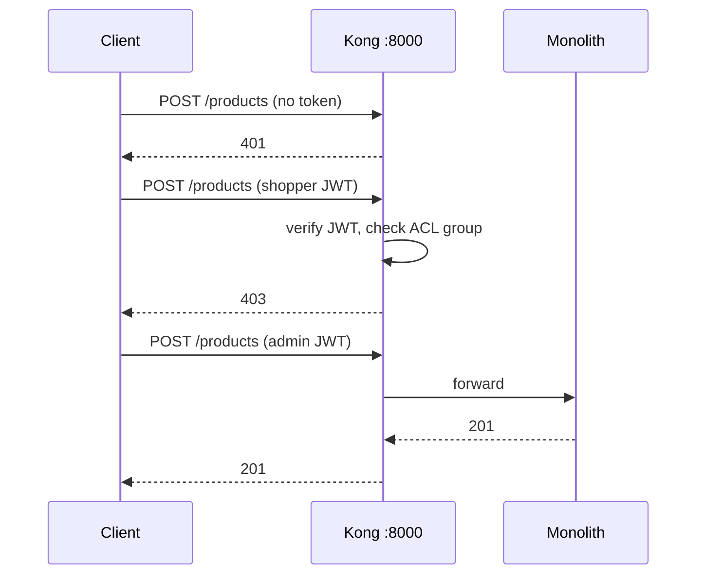
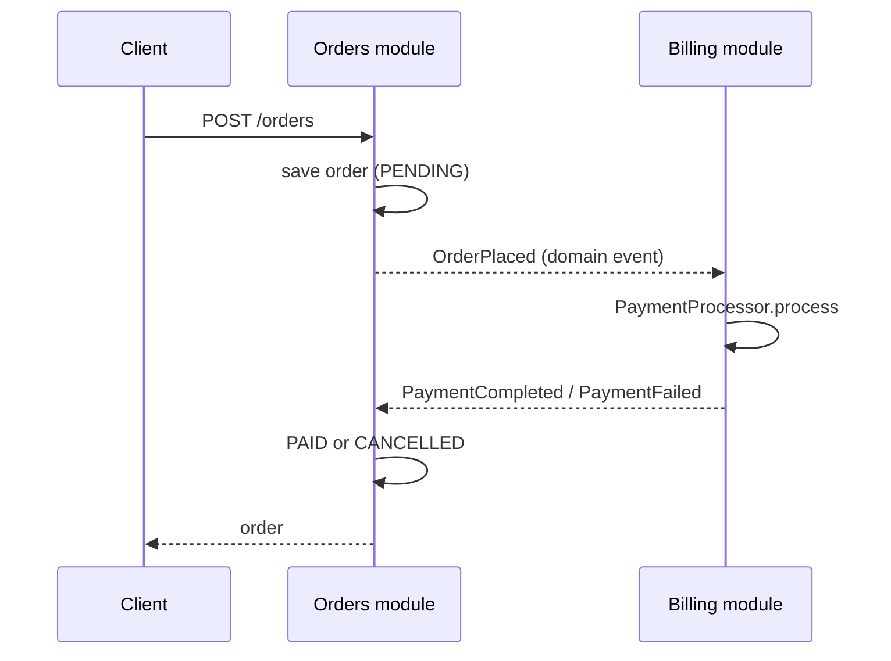
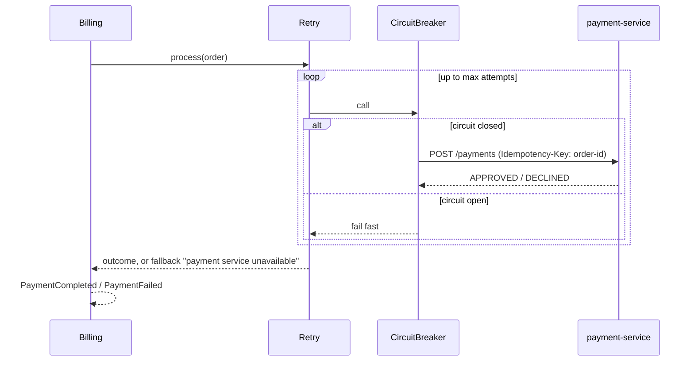
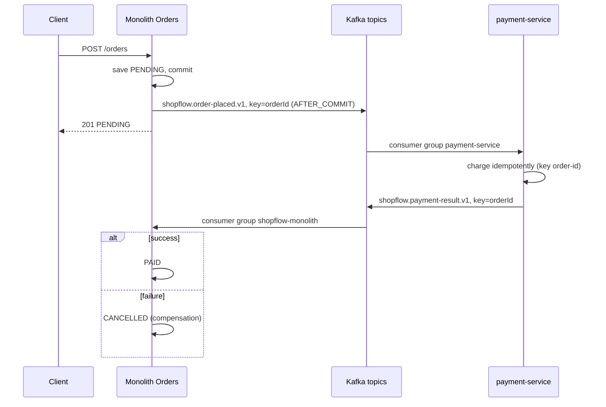
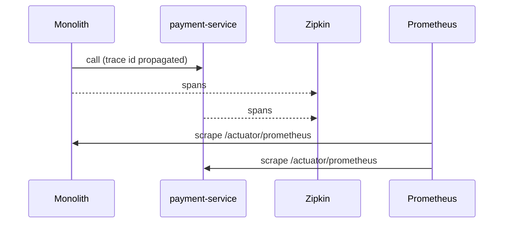

# ShopFlow sequence diagrams

## 1. Gateway: JWT + ACL

## 2. Place order, local mode (in-process domain events)

## 3. Place order, rest mode (strangler + resilience)

## 4. Place order, kafka mode (choreographed saga)

## 5. Observability

