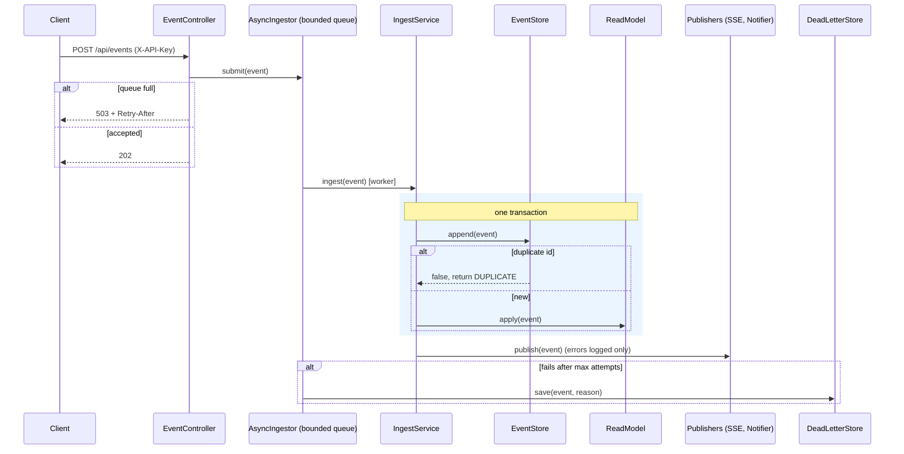
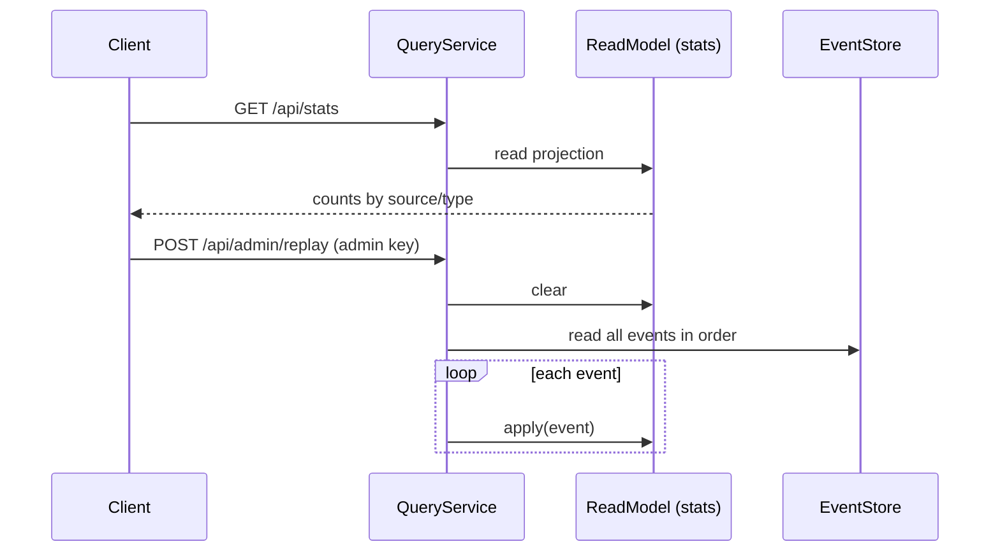
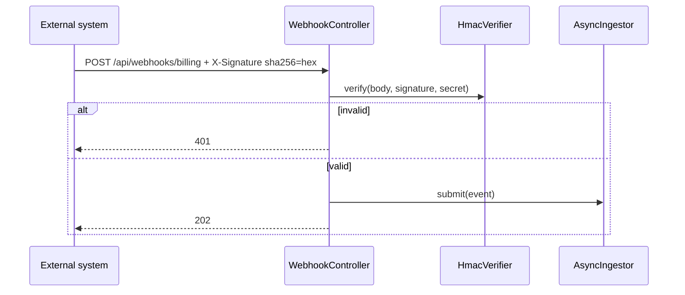
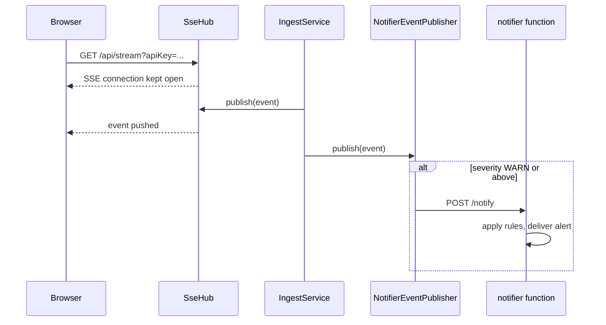
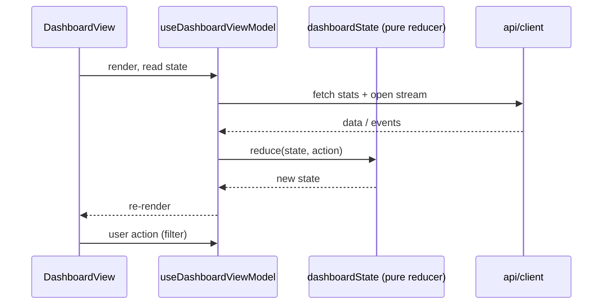
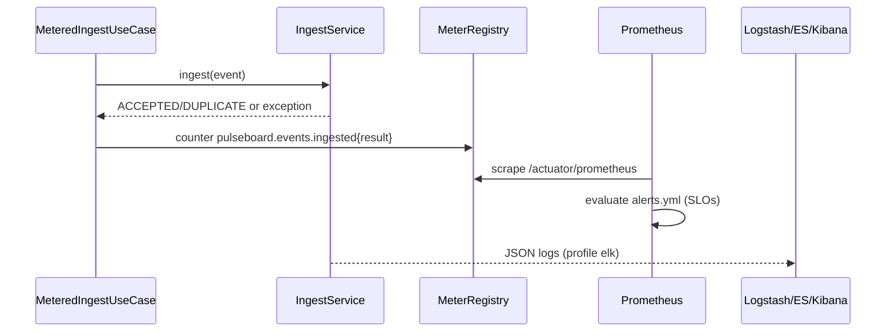
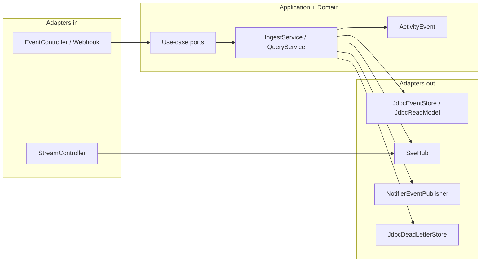

# PulseBoard sequence diagrams

## 1. Ingest: async queue, CQRS write path, DLQ

## 2. CQRS read and replay

## 3. Webhook with HMAC

## 4. Live stream and notifier fan-out

## 5. Dashboard MVVM

## 6. Observability

## Hexagon overview

